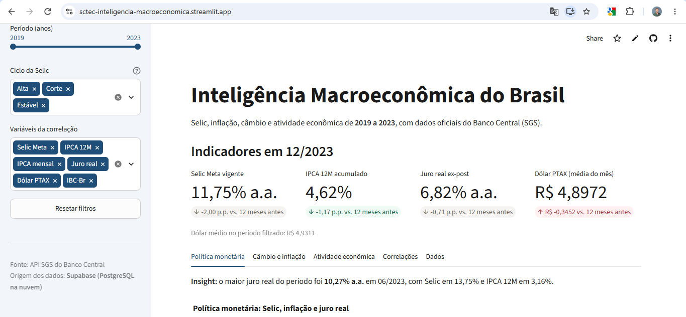
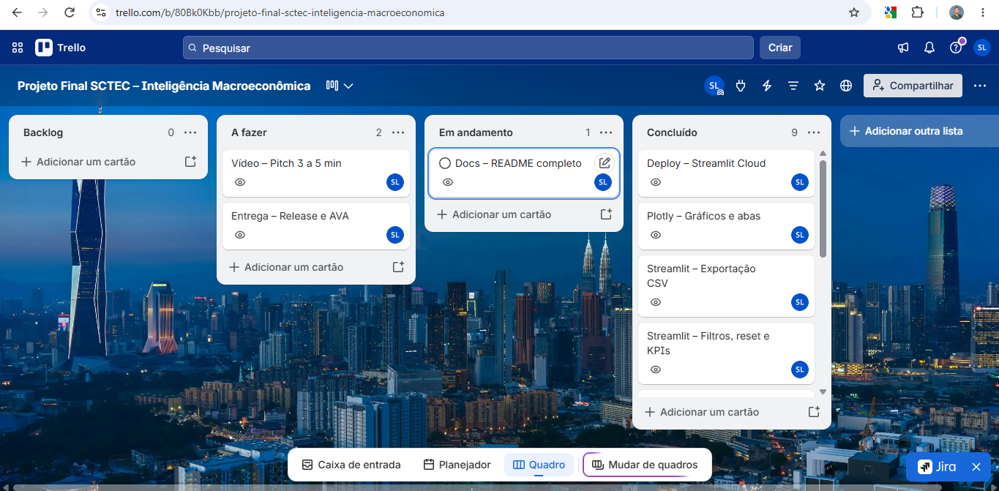

# Inteligência Macroeconômica do Brasil (2019–2023)

> Data App em Streamlit que analisa Selic, inflação, câmbio e atividade econômica com dados oficiais do Banco Central.

**🔗 App:** [Abrir o app](https://sctec-inteligencia-macroeconomica.streamlit.app) · **🎥 Vídeo:** [LINK_DO_VIDEO] · **📋 Trello:** [Quadro Kanban](https://trello.com/b/80Bk0Kbb/projeto-final-sctec-inteligencia-macroeconomica)

---

## 1. Resumo executivo

Painel interativo que analisa como a política de juros do Banco Central se relacionou com inflação, câmbio e atividade econômica entre 2019 e 2023. O Brasil passou 20 meses com juro real negativo entre 2020 e 2022, e em 2023 o juro real chegou a 10,27% a.a., o maior do período.

## 2. Contexto de negócio e pergunta orientadora

Entre 2019 e 2023 o Brasil passou por Selic mínima histórica, choque cambial na pandemia, o ciclo de alta mais forte em décadas e o início da desinflação. Para um diretor financeiro, entender esse ciclo ajuda a decidir sobre custo de dívida, proteção cambial e planejamento de demanda.

**Pergunta orientadora:** como o ciclo de juros de 2019 a 2023 se relacionou com o custo real do dinheiro, o câmbio, a inflação e a atividade econômica?

Perguntas de negócio respondidas pelo app:

1. Como a Selic Meta evoluiu e quando o juro real ex-post foi mais alto?
2. Qual foi a trajetória do dólar PTAX e em que janelas ficou acima da média do quinquênio?
3. Há correlação visual e estatística entre alta do dólar e avanço do IPCA?
4. Como o IBC-Br se comportou nos períodos de alta e de corte da Selic?
5. Quais pares de variáveis têm as maiores correlações de Pearson?

## 3. Fonte de dados e licença

| Código SGS | Série                   | Frequência           | Unidade          |
| ----------- | ------------------------ | --------------------- | ---------------- |
| 432         | Meta Selic               | Diária               | % a.a.           |
| 433         | IPCA mensal              | Mensal                | %                |
| 13522       | IPCA acumulado 12 meses  | Mensal                | %                |
| 1           | Dólar comercial (venda) | Diária (dias úteis) | reais por dólar |
| 24364       | IBC-Br dessazonalizado   | Mensal                | Índice          |

- **Fonte:** API pública do Sistema Gerenciador de Séries Temporais (SGS) do Banco Central do Brasil.
- **Período:** 01/01/2019 a 31/12/2023.
- **Extração:** `requests` na URL `https://api.bcb.gov.br/dados/serie/bcdata.sgs.{codigo}/dados`, com data inicial e final, uma chamada por série e pausa de 1 s entre chamadas.
- **Licença:** dados abertos do BCB, Open Data Commons Open Database License (ODbL).

## 4. Pipeline de engenharia de dados

```
API SGS ──► data/raw (5 CSVs brutos) ──► limpeza e tipagem ──► agregação mensal ──► indicadores ──► data/processed/base_macro_mensal.csv ──► Supabase (PostgreSQL)
```

1. **Extração** (`src/extracao.py`): baixa as 5 séries e grava cada uma em `data/raw`.
2. **Limpeza** (`src/transformacao.py`): converte datas `dd/mm/aaaa` para `datetime`, valores de texto para `float`, remove nulos e duplicados por data e registra tudo em `data/processed/relatorio_qualidade.csv`.
3. **Padronização mensal:** Selic = último valor do mês; dólar = média do mês; demais séries já são mensais.
4. **Validação:** a base precisa ter exatamente 60 meses e nenhum valor nulo nas 5 séries.
5. **Indicadores:** juro real ex-post, variação do dólar em 12 meses, flag de dólar acima da média e ciclo da Selic.
6. **Carga** (`src/carga.py`): envia a tabela `base_macro_mensal` ao Supabase via SQLAlchemy.

**Fórmula do juro real ex-post:** `((1 + Selic/100) / (1 + IPCA12M/100) − 1) × 100`

**Relatório de qualidade:**

| Série             | Linhas brutas | Nulos removidos | Duplicados removidos | Linhas finais |
| ------------------ | ------------- | --------------- | -------------------- | ------------- |
| 432 – Selic Meta  | 1826          | 0               | 0                    | 1826          |
| 433 – IPCA mensal | 60            | 0               | 0                    | 60            |
| 13522 – IPCA 12M  | 60            | 0               | 0                    | 60            |
| 1 – Dólar PTAX   | 1255          | 0               | 0                    | 1255          |
| 24364 – IBC-Br    | 60            | 0               | 0                    | 60            |

Após a agregação mensal, a base consolidada ficou com 60 meses e nenhum valor nulo nas séries principais. A coluna `dolar_var_12m` tem 12 nulos em 2019 por definição, pois não existe mês de comparação.

## 5. Dicionário de dados

| Coluna            | Tipo     | Significado                                     | Regra de cálculo                                              |
| ----------------- | -------- | ----------------------------------------------- | -------------------------------------------------------------- |
| data_ref          | datetime | Primeiro dia do mês de referência             | Mês das séries (AAAA-MM-01)                                  |
| ano               | int      | Ano de referência                              | Extraído de `data_ref`                                      |
| selic_meta        | float    | Meta Selic vigente no fim do mês (% a.a.)      | Série 432, último valor do mês                              |
| ipca_mensal       | float    | Inflação do mês (%)                          | Série 433                                                     |
| ipca_12m          | float    | Inflação acumulada em 12 meses (%)            | Série 13522                                                   |
| dolar_ptax        | float    | Dólar médio do mês (reais por dólar)        | Série 1, média mensal                                        |
| ibc_br            | float    | Índice de atividade econômica dessazonalizado | Série 24364                                                   |
| juro_real_ex_post | float    | Juro real efetivo (% a.a.)                      | Fórmula acima                                                 |
| dolar_var_12m     | float    | Variação do dólar em 12 meses (%)            | Variação contra 12 meses antes; nulo em 2019 por definição |
| dolar_acima_media | bool     | Dólar acima da média 2019–2023               | `dolar_ptax` > média do quinquênio                         |
| ciclo_selic       | str      | Alta, Corte ou Estável                         | Variação da Selic contra o mês anterior                     |

## 6. Tecnologias e bibliotecas

| Ferramenta                     | Uso                              | Por quê                                     |
| ------------------------------ | -------------------------------- | -------------------------------------------- |
| Python 3.11+                   | Linguagem do projeto             | Padrão de mercado em dados                  |
| requests                       | Chamadas à API do BCB           | Simples e com controle de timeout            |
| pandas / numpy                 | Limpeza, agregação e cálculos | Séries temporais com `resample`           |
| SQLAlchemy + psycopg2          | Carga no PostgreSQL              | Integração direta com `DataFrame.to_sql` |
| Supabase                       | PostgreSQL na nuvem              | Plano gratuito e acesso via pooler IPv4      |
| Streamlit                      | Data App                         | Interface interativa só com Python          |
| Plotly Express / Graph Objects | Gráficos                        | Interatividade (hover, zoom)                 |
| Streamlit Community Cloud      | Deploy                           | Publicação gratuita integrada ao GitHub    |
| Trello / Git / GitHub          | Gestão e versionamento          | Kanban e GitFlow exigidos no projeto         |

## 7. Principais resultados

1. **Política monetária:** a Selic foi de 2% a 13,75%; o juro real ficou negativo de meados de 2020 ao início de 2022 (20 meses, com mínimo de -4,35% em 2021) e em 2023 chegou a 10,27% a.a.
2. **Câmbio:** o dólar médio de 2019 a 2023 foi de 4,93 reais. Ele ficou acima dessa média em 39 dos 60 meses, a partir de abril de 2020, com picos de cerca de 5,65 reais em maio de 2020 e dezembro de 2021, e voltou abaixo da média em abril de 2022 e no meio de 2023.
3. **Câmbio × inflação:** a correlação de Pearson entre o dólar e o IPCA 12M foi de 0,36, positiva mas fraca. O dólar disparou em 2020, mas a inflação só acelerou com força em 2021, o que sugere uma relação defasada no tempo, e não simultânea. Correlação não implica causalidade.
4. **Atividade:** entre janeiro de 2019 e dezembro de 2023, o IBC-Br cresceu 8,2%, mesmo atravessando o maior ciclo de alta da Selic do período, com a queda forte concentrada no choque da pandemia, em 2020.
5. **Correlações:** os pares mais correlacionados foram Juro real × Selic (0,78), esperado, já que o juro real é calculado a partir da Selic, e Selic × IBC-Br (0,73). Este último reflete uma tendência comum, com recuperação da atividade após a pandemia ao mesmo tempo que a Selic subia, e não indica que juros altos estimulem a economia. O dólar quase não se correlacionou com a Selic (0,04) nem com o IBC-Br (-0,02).

**Contexto da pandemia de COVID-19**

As fases da pandemia coincidem com os principais movimentos das séries. O painel mostra essas coincidências no tempo, mas não isola o efeito da pandemia de outros fatores.

| Período      | Fato da pandemia                                                                               | O que aparece nos dados                                                             |
| ------------- | ---------------------------------------------------------------------------------------------- | ----------------------------------------------------------------------------------- |
| Mar/2020      | OMS declara pandemia; estados brasileiros iniciam quarentenas                                  | O dólar passa a ficar acima da média do período a partir de abril de 2020        |
| Abr–Mai/2020 | Auge das restrições da primeira onda                                                         | Pico do dólar, cerca de 5,65 reais em maio de 2020, e queda mais forte do IBC-Br   |
| Ago/2020      | Reabertura gradual                                                                             | Selic no mínimo histórico de 2%                                                   |
| 2º sem./2020 | Retomada da economia com cadeias globais desorganizadas                                        | IPCA em alta e juro real negativo                                                   |
| Mar–Abr/2021 | Segunda onda; abril de 2021 é o mês mais letal no Brasil, com recorde de 4.249 mortes em 24h | Juro real perto do mínimo do período (-4,35%) e início do ciclo de alta da Selic |
| 2022          | Fim das restrições                                                                           | Selic chega a 13,75% e o juro real volta a ser positivo                             |

## 8. Discussão e limitações

- São apenas 60 observações mensais; correlações nessa amostra são instáveis.
- **Correlação não implica causalidade.** O app mostra associações, não efeitos causais.
- O choque da pandemia de COVID-19 (quarentenas de 2020 e pico de mortes em abril de 2021) distorce médias e correlações do período, e o painel não isola o efeito da pandemia de outros fatores, como juros globais e preços de commodities.
- Juro real ex-post usa a inflação passada; não representa o juro real esperado.
- O IBC-Br é revisado periodicamente pelo BCB.
- O dólar mensal é uma média; picos diários não aparecem.

## 9. Aplicação profissional

- **CFO / tesouraria:** avaliar o custo real da dívida pós-fixada e o momento de trocar por prefixada.
- **Compras e importação:** identificar janelas de dólar acima da média para planejar hedge.
- **Planejamento comercial:** acompanhar o IBC-Br como termômetro de demanda em ciclos de juros altos.

## 10. Demonstração do Data App

**Link:** [Abrir o app](https://sctec-inteligencia-macroeconomica.streamlit.app)



**Guia de navegação:**

- **Barra lateral:** período, ciclo da Selic, variáveis da correlação e botão *Resetar filtros*. O rodapé mostra a origem dos dados (Supabase ou CSV de contingência).
- **KPIs:** Selic, IPCA 12M, juro real e dólar no último mês do período, com variação contra 12 meses antes.
- **Abas:** Política monetária · Câmbio e inflação · Atividade econômica · Correlações · Dados (com download CSV).

## 11. Como executar localmente

```bash
git clone https://github.com/engsergioleite/sctec-inteligencia-macroeconomica.git
cd sctec-inteligencia-macroeconomica
python -m venv .venv
.venv\Scripts\activate          # Windows  (Linux/Mac: source .venv/bin/activate)
pip install -r requirements.txt

# Credenciais do Supabase (opcional: sem elas o app usa o CSV)
copy .streamlit\secrets.toml.example .streamlit\secrets.toml

# ETL completo (use --sem-carga para não enviar ao Supabase)
python pipeline.py

streamlit run app.py
```

## 12. Estrutura de pastas

```
├── .streamlit/        # tema (config.toml) e modelo de credenciais
├── data/raw/          # séries brutas da API SGS
├── data/processed/    # base mensal consolidada (também é o fallback do app)
├── docs/img/          # prints do app e do Trello
├── notebooks/         # análise exploratória
├── src/               # módulos de ETL: config, extração, transformação, carga
├── app.py             # Data App em Streamlit
├── pipeline.py        # executa o ETL de ponta a ponta
└── requirements.txt
```

## 13. Gestão ágil e links do projeto

- **Trello (Kanban):** [Quadro do projeto](https://trello.com/b/80Bk0Kbb/projeto-final-sctec-inteligencia-macroeconomica)
- **App em produção:** [Abrir o app](https://sctec-inteligencia-macroeconomica.streamlit.app)
- **Vídeo de apresentação:** [LINK_DO_VIDEO]



Versionamento em GitFlow: `main` (estável), `develop` (integração) e uma `feature/*` por funcionalidade, com commits semânticos no imperativo.

## 14. Autoria e créditos

**Sérgio Fonseca Leite Junior** · [LinkedIn](https://www.linkedin.com/in/sergio-f-leite-jr) · [GitHub](https://github.com/engsergioleite)

Projeto Avaliativo Final – Visualização de Dados e Business Intelligence – SCTEC / SENAI-SC.

**Referências**

- Banco Central do Brasil – Dados Abertos / API SGS: https://dadosabertos.bcb.gov.br
- Documentação do Streamlit: https://docs.streamlit.io
- Documentação do Plotly: https://plotly.com/python
- Documentação do Supabase: https://supabase.com/docs
- Correio Braziliense – Brasil bate recorde de 4.249 mortes por covid em 24h (abril de 2021): https://www.correiobraziliense.com.br/brasil/2021/04/4917167-novo-recorde-de-mortesem-apenas-24h-4.html
- Metrópoles – Abril de 2021 é o mês mais letal da pandemia: https://www.metropoles.com/brasil/abril-ja-registra-mais-de-70-mil-mortes-e-e-mes-mais-letal-da-pandemia

### Uso de Inteligência Artificial no desenvolvimento

**O que eu fiz**

- Executei o pipeline de ETL com os dados reais da API do Banco Central e validei o relatório de qualidade.
- Construí o notebook de análise exploratória com pandas e Plotly e interpretei os resultados das cinco perguntas de negócio, incluindo a identificação de correlação espúria entre Selic e IBC-Br.
- Criei e configurei o banco PostgreSQL no Supabase, com Row Level Security e credenciais fora do repositório.
- Publiquei o app no Streamlit Community Cloud, configurei os secrets e organizei a gestão no Trello e no GitHub.
- Diagnostiquei e corrigi problemas reais: o driver do PostgreSQL alterado na versão nova do SQLAlchemy, os rótulos com cifrão interpretados como fórmula pelo Plotly e o kernel errado do notebook.

**Como usei a IA**

O projeto foi desenvolvido com apoio de IA generativa (Claude, da Anthropic), utilizada como assistente técnico: planejamento das etapas, geração da versão inicial do código do ETL e do Data App, explicação de conceitos e revisão dos textos deste README. Todo o código foi executado, testado e ajustado por mim utilizando a IA como apoio e com os dados reais, e as análises e interpretações dos resultados descritas neste README são de minha autoria com apoio da IA para edição de textos.

**O que aprendi**

Manipulação de dados com pandas, visualização com Plotly, ambientes virtuais, GitFlow, gestão de credenciais, cache no Streamlit, banco de dados na nuvem e a diferença entre correlação e causalidade.
